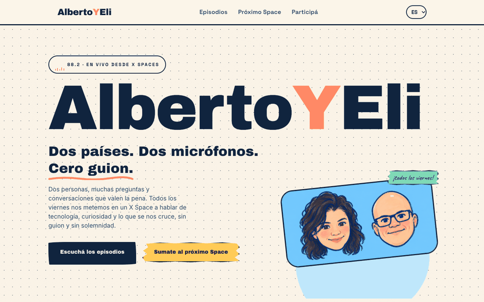

<div align="center">
  <a href="https://mariaelisaaraya.github.io/albertoyeli_tienenunspace/">
    
  </a>

  <h1>Alberto<span style="color:#ff765f">Y</span>Eli</h1>

  <p><strong>Dos países. Dos micrófonos. Cero guion.</strong></p>
  <p>Un rincón para las conversaciones que empiezan en X Spaces y siguen acá.</p>

  <a href="https://mariaelisaaraya.github.io/albertoyeli_tienenunspace/">✦ Entrar al sitio</a>
  &nbsp;·&nbsp;
  <a href="https://mariaelisaaraya.github.io/albertoyeli_tienenunspace/episodios/">Escuchar episodios</a>
  &nbsp;·&nbsp;
  <a href="#contribuciones">Sumar una idea</a>

  <br><br>

  
  
  
  <a href="https://github.com/mariaelisaaraya/albertoyeli_tienenunspace/actions/workflows/deploy.yml"></a>
  
</div>

<br>

<div align="center">
  <a href="https://mariaelisaaraya.github.io/albertoyeli_tienenunspace/">
    
  </a>
  <p><em>Un vistazo al sitio. Tocá el GIF para entrar y explorar.</em></p>
</div>

## Un podcast, muchas puertas de entrada

Cada episodio tiene su resumen, audio y, cuando está disponible, transcripción con marcas de tiempo. Buscá por tema, encontrá a las personas invitadas y seguí la charla en español, inglés o portugués.

- **Episodios:** ideas y aprendizajes para escuchar a tu ritmo.
- **Personas:** conocé a Eli y Alberto, y a quienes se suman al micrófono.
- **Próximo Space:** fecha, horario local y opción para guardarlo en Google Calendar.
- **Participá:** ¿tenés algo para compartir? El micrófono también puede ser tuyo.

## Correrlo en tu compu

Necesitás Node.js 22.22 o una versión posterior.

```bash
npm install
npm run dev
```

Abrí la dirección que muestra Astro (por defecto `http://localhost:4321/albertoyeli_tienenunspace/`). Para revisar la versión de producción:

```bash
npm run check
npm run build
npm run preview
```

## Contribuciones

### ¡Tus PRs son más que bienvenidos! 💛

¿Viste algo para corregir, se te ocurrió una mejora o querés sumar una idea? Abrí un issue o mandá un pull request. Para cambios grandes, contanos primero en un issue y lo pensamos en comunidad. Cada aporte ayuda a que este espacio siga creciendo.

Si el cambio suma un episodio, cuidemos que la fecha, el resumen y los enlaces reflejen lo que pasó en el Space. El audio y la transcripción se agregan cuando están disponibles y tenemos permiso para publicarlos.

## English

**Two countries. Two microphones. No script.** AlbertoYEli is a home for conversations that start on X Spaces and keep going here. Browse episode summaries, listen to the audio, search transcripts and switch between Spanish, English and Portuguese.

Contributions are very welcome! Open an issue with an idea or send a pull request. For bigger changes, start with an issue and let's talk about it together. 💛

## Português

**Dois países. Dois microfones. Sem roteiro.** AlbertoYEli é um espaço para conversas que começam no X Spaces e continuam aqui. Explore os resumos, ouça os episódios, busque nas transcrições e alterne entre espanhol, inglês e português.

Contribuições são muito bem-vindas! Abra uma issue com sua ideia ou envie um pull request. Para mudanças maiores, comece pela issue e vamos conversar. 💛
